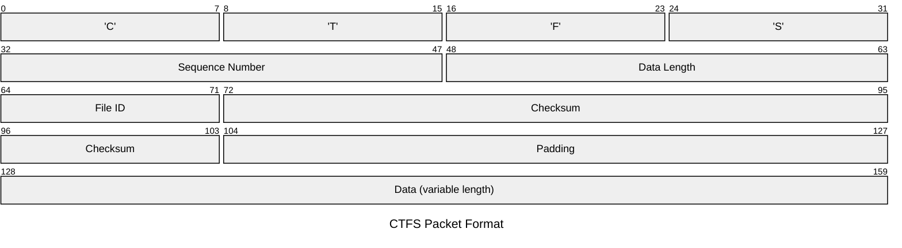
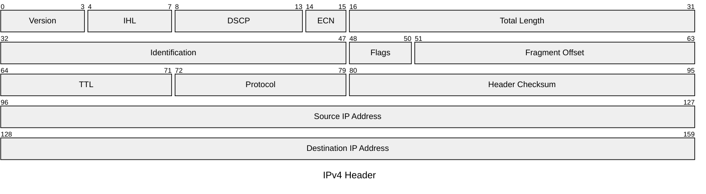

# CoreTech _Operation FIRE STORM_

## Summary

This repository contains the C++ source code and build infrastructure for the [_Operation FIRE
STORM_](https://github.com/CoreTechSecurity/fire-storm) and _FIRE STORM: Superheated_ challenges from CoreTech Security.
This solution is submitted in partial fulfilment of **Oliver Dixon**'s application to the
[2027 Graduate Software Engineer position](https://jobs.eu.lever.co/coretechsecurity/31809178-6182-46d2-9baf-700f410a45de)
at CoreTech Security.

The solution satisfies all mandatory and optional functional requirements as defined by the Stage 1 and Stage 2 briefs:

* Reading TCP traffic from the localhost on port 5733;
* Extracting and reordering operational data for reconstruction into PDF documents;
* In Stage 1, redirecting all non-operational data to the local endpoint on port 5744;
* In Stage 2, routing non-operational data to local endpoints on ports 5744, 5745, or 5746 in accordance with a fixed
  routing policy based on Ethernet frame metadata.
* Dropping packets with invalid checksums.
* Supporting optional build-time hardening to resist inspection by static and dynamic analysis tools.

Additionally, non-functional requirements such as runtime performance, detection vulnerability, and resource
requirements were considered. These are discussed under [_Performance Considerations_](#performance-considerations)
and [_Hardening Considerations_](#hardening-considerations).

Correctness can be verified with the supplied Python scripts and a range of additional unit tests. Preparation and use
of the application and test suites are discussed under [_Building_](#building) and [_Execution_](#execution). In
addition to local testing, GitHub Actions is used to provide a CI pipeline; previous runs can be found
at https://github.com/oliverdixon/coretech-firestorm-2027/actions/workflows/buildtest.yml.

## Building

Building the software requires the following components:

* A Linux environment or similar.
* A modern standards-compliant C++ compiler and POSIX standard library implementation: at least Clang 18 or GCC 13;
* CMake 3.28 or greater;
* A CMake-compatible build system: `make` or (preferably) Ninja.
* Optionally, Doxygen to generate HTML documentation from inline source comments.
* Optionally, a Python3 interpreter to run the CoreTech integration tests.

These are available from `apt` on the Ubuntu 24.04 LTS baseline.

### Building the Standalone Application

To build _FIRE STORM_ for use with the supplied Python test cases, generate the build script for the desired
configuration preset (`debug-app` or `release-app`) and build it:

```
$ cmake --preset debug-app
$ cmake --build cmake-build-debug-app
```

In the debug configuration, minimal optimisation is undertaken, and all debugging symbols are left resident in the
executable. At runtime, log messages are produced on `stdout` and `stderr` to indicate status and warnings. In the
release configuration, extensive optimisation and hardening takes place to resist analysis and detection; these methods
are discussed in [_Hardening Considerations_](#hardening-considerations).

### Building the Test Suites

To build the _FIRE STORM_ automated unit test suite, use the `debug-tests` or `release-tests` target as desired. The
test targets are packed with a small executable shim to execute and report the results of all unit tests:

```
$ cmake --preset debug-tests
$ cmake --build cmake-build-debug-tests
```

## Documentation

To build HTML documentation, invoke `doxygen` in the repository root:

```
$ doxygen
$ xdg-open docs/html/index.html
```

Alternatively, the rendered HTML can be viewed interactively online at https://owd.semanticpad.com/coretech-firestorm/.
Prior to the submission deadline, viewing the documentation requires HTTPS authentication with the credentials:

* Username: `coretech`
* Password: `coretech`

## Execution

### Running the Standalone Application

To run _FIRE STORM_ interactively, locate the `FireStorm` executable in the build directory: either
`cmake-build-debug-app` or `cmake-build-release-app`, relative to the location of `CMakeLists.txt`. Following each
invocation, a set of PDF documents will be produced in the current working directory.

#### Stage 1 Invocation

To run _FIRE STORM_ in the Stage 1 configuration, in which all non-operational data is forwarded to the endpoint at
127.0.0.1:5744, execute the binary without any command-line parameters. The program will hang until data is received on
127.0.0.1:5733 from the provided Python script.

```
$ cmake-build-debug-app/FireStorm &
$ python3 coretech/stage1/test.py --quiet
Running test...
[Info] src/AsyncFrameSink.cpp:123 says: Established forwarding TCP connection to 127.0.0.1:5744.
[Warn] src/TrafficDecoder.hpp:271 says: Found CTFS packet (F#1, S#18) with bad checksum: expected 0XCDF7548D, got 0XFCE0EA3B.
[Info] src/Driver.cpp:90 says: Reconstructed 20 packets with File ID 1 into 1.pdf.
[Info] src/PassthroughAsyncFrameRouter.cpp:37 says: Under the passthrough policy, 257 frames have been forwarded.
[Info] src/PassthroughAsyncFrameRouter.cpp:38 says: To the endpoint 127.0.0.1:5744, 257 frames were sent, and 0 were dropped.
----------------------------------------------------------------------
Ran 1 test in 6.004s

OK
```

#### Stage 2 Invocation

To run _FIRE STORM_ in the Stage 2 configuration, in which non-operational data is routed to local endpoints on ports
5744, 5745, and 5746 according to a fixed policy, execute the binary with the `--classified` command-line parameter. The
program will similarly hang until data is received on 127.0.0.1:5733.

```
$ cmake-build-debug-app/FireStorm --classified &
$ python3 coretech/stage2/test.py --quiet
Running test...
[Info] src/AsyncFrameSink.cpp:123 says: Established forwarding TCP connection to 127.0.0.1:5744.
[Info] src/AsyncFrameSink.cpp:123 says: Established forwarding TCP connection to 127.0.0.1:5745.
[Info] src/AsyncFrameSink.cpp:123 says: Established forwarding TCP connection to 127.0.0.1:5746.
[Warn] src/TrafficDecoder.hpp:271 says: Found CTFS packet (F#2, S#689) with bad checksum: expected 0XB3274CBE, got 0XC740DA9D.
[Warn] src/TrafficDecoder.hpp:271 says: Found CTFS packet (F#4, S#337) with bad checksum: expected 0X48D1243B, got 0X48D1252B.
[Warn] src/TrafficDecoder.hpp:271 says: Found CTFS packet (F#3, S#225) with bad checksum: expected 0X16CE432F, got 0X16CE441F.
[Warn] src/TrafficDecoder.hpp:271 says: Found CTFS packet (F#0, S#558) with bad checksum: expected 0X67976CB8, got 0X30211A91.
[Info] src/Driver.cpp:90 says: Reconstructed 560 packets with File ID 0 into 0.pdf.
[Info] src/Driver.cpp:90 says: Reconstructed 739 packets with File ID 1 into 1.pdf.
[Info] src/Driver.cpp:90 says: Reconstructed 691 packets with File ID 2 into 2.pdf.
[Info] src/Driver.cpp:90 says: Reconstructed 227 packets with File ID 3 into 3.pdf.
[Info] src/Driver.cpp:90 says: Reconstructed 339 packets with File ID 4 into 4.pdf.
[Info] src/ClassifiedAsyncFrameRouter.cpp:77 says: Under the classifying policy, 210 frames have been routed, of which 55 were excluded from their primary route.
[Info] src/ClassifiedAsyncFrameRouter.cpp:85 says: To the endpoint 127.0.0.1:5744, 193 frames were sent, and 0 were dropped.
[Info] src/ClassifiedAsyncFrameRouter.cpp:85 says: To the endpoint 127.0.0.1:5745, 93 frames were sent, and 0 were dropped.
[Info] src/ClassifiedAsyncFrameRouter.cpp:85 says: To the endpoint 127.0.0.1:5746, 3 frames were sent, and 0 were dropped.
----------------------------------------------------------------------
Ran 1 test in 6.038s

OK
```

### Running the Unit and Integration Tests

Alternatively, if the test suite was built as in [_Building the Test Suite_](#building-the-test-suites), unit and
integration tests can be run with CTest:

```
$ ctest --test-dir cmake-build-debug-tests --output-on-failure
```

Unit or integration tests may be run in isolation by specifying the `Unit` or `Integration` label:

```
$ ctest --test-dir cmake-build-debug-tests --output-on-failure -L Unit
$ ctest --test-dir cmake-build-debug-tests --output-on-failure -L Integration
```

### Checksum Errors

By default, operational packets that report invalid checksums are reported but not dropped. To refuse packets that fail
checksum validation, pass `--reject-bad-checksums` on the command line.

## Software and Interface Description

### Interface Description

There are two central interfaces known to the _FIRE STORM_ application: operational data (CTFS), and non-operational
data; non-operational data may be sent over TCP/IP or UDP/IP. All packets are sent in network byte order (Big Endian);
no assumptions are made on the host byte ordering. At the IP layer, only IPv4 is supported.

#### Operational Data Packets

The CTFS protocol specification consists of a 16-byte header followed by an arbitrary amount of data. They are
identified by the magic bytes `CTFS`.



#### Non-Operational Data Transport Headers

The Ethernet headers of non-operational data detain MAC addresses and EtherTypes:


The EtherType field is set according to the IP version in use:

| IP Version | EtherType | 
|------------|-----------|
| IPv4       | `0x0800`  |  
| IPv6       | `0x86DD`  |  

Ethernet headers are followed by the IPv4 header:
[RFC 791](https://datatracker.ietf.org/doc/html/rfc791#section-3.1),
[RFC 2474](https://datatracker.ietf.org/doc/html/rfc2474#section-3),
[RFC 3168](https://datatracker.ietf.org/doc/html/rfc3168#section-5).



The Protocol field denotes the transport protocol:

| Transport Protocol | Value |
|--------------------|-------|
| TCP                | `6`   |
| UDP                | `17`  |

### Capture and Routing Details

#### Operational Data

Data identified as operational is captured, decoded according to the protocol definition, and reordered in a strong
ordering according to its File ID and Sequence Number. Following the transmission, payloads of operational data are
concatenated in the strong ordering and formed into a single PDF document, which is exported with the filename
`./N.pdf`, where `N` is the File ID.

#### Non-Operational Data

In Stage 1, all non-operational data is forwarded to the endpoint 127.0.0.1:5744.

In Stage 2, non-operational data is segmented according to its source MAC, destination MAC, and protocol.

<table>
<thead>
  <tr>
    <th>Classification</th>
    <th>Transport Protocol</th>
    <th>Routing Destination</th>
    <th>Source MAC Prefix</th>
    <th>Destination MAC Prefix</th>
  </tr>
</thead>
<tbody>
  <tr>
    <td rowspan="3">Monitored</td>
    <td rowspan="3">TCP/UDP</td>
    <td rowspan="3">127.0.0.1:5745</td>
    <td rowspan="3"><i>Any</i></td>
    <td>00:1A:A0</td>
  </tr>
  <tr>
    <td>00:1E:C9</td>
  </tr>
  <tr>
    <td>00:15:5D</td>
  </tr>
  <tr>
    <td rowspan="3">Malicious</td>
    <td rowspan="3">TCP/UDP</td>
    <td rowspan="3">Dropped [1]</td>
    <td>00:0C:29</td>
    <td rowspan="3"><i>Any</i></td>
  </tr>
  <tr>
    <td>00:50:56</td>
  </tr>
  <tr>
    <td>00:1C:14</td>
  </tr>
  <tr>
    <td rowspan="2">Unclassified</td>
    <td>TCP</td>
    <td>127.0.0.1:5744</td>
    <td rowspan="2" colspan="2"><i>Any</i></td>
  </tr>
  <tr>
    <td>UDP</td>
    <td>127.0.0.1:5746</td>
  </tr>
</tbody>
</table>

[1] Malicious traffic is dropped only if it is not also monitored. If a non-operational packet has a monitored
destination MAC, it will be routed in accordance with the _Monitored_ classification.

### Performance Considerations

Due to the potentially high data throughput, runtime performance was considered. The sample workloads verify correctness
but are of insufficient size to allow effective profiling. A future line of investigation would involve generating very
large data streams of operational and non-operational data and analysis _FIRE STORM_ with a dynamic analysis tool such
as [`perf`](https://man7.org/linux/man-pages/man1/perf.1.html) or
[`callgrind`](https://valgrind.org/docs/manual/cl-manual.html) to determine runtime bottlenecks.

To prevent a slow TCP forwarding endpoint slowing the application indefinitely, a combination of socket timeouts with [
`poll`](https://man7.org/linux/man-pages/man2/poll.2.html)
and [C++ threading](https://cppreference.com/cpp/header/thread) is used; in particular, transport on each forwarding
endpoint runs on an independent thread to achieve asynchronous forwarding. The async frame sink is implemented in [
`AsyncFrameSink::run_worker`](https://github.com/oliverdixon/coretech-firestorm-2027/blob/894ca924e7f3b4af8e3a5df23b7fa0f97c883099/src/AsyncFrameSink.cpp#L168).

At the implementation level, cache-friendly STL data structures such as ([
`std::vector`](https://en.cppreference.com/cpp/container/vector) and similar) are used over node-based structures.
Copying large amounts of data is elided by using lightweight non-owning ranges, such as
[`std::span`](https://en.cppreference.com/cpp/container/span), with documented lifetime guarantees. Repeated dynamic
allocation is avoided where possible, and buffers are maintained using heuristics to avoid
excessive work during hot loops (see, for example, [
`TrafficDecoder::compact`](https://github.com/oliverdixon/coretech-firestorm-2027/blob/894ca924e7f3b4af8e3a5df23b7fa0f97c883099/src/TrafficDecoder.cpp#L44)).
Where possible, ranges are statically sized through template specialisation to encourage more aggressive optimisation;
see, for example, [C++20 statically sized `std::span`](https://en.cppreference.com/cpp/container/span/span).

Preliminary profiling with `perf` on the smaller workloads indicated that _FIRE STORM_ is network-bound in the speed of
the UNIX sockets, such that further optimisation of the C++ implementation would be unlikely to improve execution
performance. If the application became compute-bound under higher workloads, frames could be batched prior to being
sent, with the consequences of increasing complexity of object lifetime semantics and potentially increasing the amount
of synchronisation mechanisms required to control ownership; this would require profiling, as it could have a
detrimental impact on performance due to locking.

### Hardening Considerations

If configured and built with the Release CMake preset, the _FIRE STORM_ will undergo various build-time hardening
processes through the use of compiler and linker flags followed by stripping. To debug release builds, `llvm-objcopy`
can be used to separate the stripped ELF from debugging symbols, the latter of which can be kept private.

As the packet decoder necessarily uses hardcoded strings to detect operational data, a reverse-engineer could learn the
purpose of the application with the `strings` command, although the logic remains obfuscated.

<table>
<thead>
  <tr>
    <th>Stage</th>
    <th>Flag</th>
    <th>Rationale</th>
  </tr>
</thead>
<tbody>
  <tr>
    <td rowspan="7">Compile</td>
    <td><code>-O3</code></td>
    <td>Forces the highest level of optimisation (vectorisation; larger loop unrolling; function cloning).</td>
  </tr>
  <tr>
    <td><code>-DNDEBUG</code></td>
    <td>Sets the <code>NDEBUG</code> C macro to disable logging and assertions.</td>
  </tr>
  <tr>
    <td><code>-fvisibility=hidden</code></td>
    <td>Changes the default ELF symbol visibility from <code>default</code> to <code>hidden</code>.</td>
  </tr>
  <tr>
    <td><code>-fvisibility-inlines-hidden</code></td>
    <td>Performs <code>-fvisibility=hidden</code> for C++-only functions such as template instantiations.</td>
  </tr>
  <tr>
    <td><code>-fstack-protector-strong</code></td>
    <td>Inserts a stack canary into vulnerable functions to protect against stack-smashing exploits.</td>
  </tr>
  <tr>
    <td><code>-ffunction-sections</code></td>
    <td>Place functions into separate ELF sections such that the linker can individually discard unused functions.</td>
  </tr>
  <tr>
    <td><code>-fdata-sections</code></td>
    <td>Place data into separate ELF sections such that the linker can individually discard unused blocks.</td>
  </tr>
  <tr>
    <td rowspan="5">Link</td>
    <td><code>--gc-sections</code></td>
    <td>Garbage-collect unreachable ELF sections.</td>
  </tr>
  <tr>
    <td><code>-z,relro</code></td>
    <td>Relocate all possible sections into read-only memory following program startup.</td>
  </tr>
  <tr>
    <td><code>-z,now</code></td>
    <td>Requests immediately ELF symbol binding to maximise the effect of <code>-z,relro</code>.</td>
  </tr>
  <tr>
    <td><code>-z,noexecstack</code></td>
    <td>Marks code on the executable's stack as non-executable to mitigate code injection.</td>
  </tr>
  <tr>
    <td><code>-pie</code></td>
    <td>Enforces position-independent addresses to enable effective address space layout randomisation.</td>
  </tr>
</tbody>
</table>

Statically linking the standard library was also considered, but since _FIRE STORM_ does not cross privilege boundaries,
it was not considered necessary to mitigate `LD_PRELOAD` attacks.
