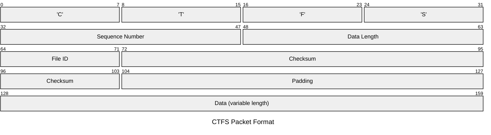

# CoreTech _Operation FIRE STORM_

## Summary

This repository contains the C++ source code and build infrastructure for the _Operation FIRE STORM_ and _FIRE STORM:
Superheated_ challenges from CoreTech Security. This solution is submitted in partial fulfilment of application to the
2027 graduate Junior Consultant position at CoreTech Security.

The solution satisfies all mandatory and optional functional requirements as defined by the Stage 1 and Stage 2 briefs:

* Reading TCP traffic from the localhost on port 5733;
* Extracting and reordering operational data for reconstruction into PDF documents;
* In Stage 1, redirecting all non-operational data to the local endpoint on port 5744;
* In Stage 2, routing non-operational data to local endpoints on ports 5744, 5745, or 5746 in accordance with a fixed
  routing policy based on Ethernet frame metadata.
* Dropping packets with invalid checksums.
* Supporting optional build-time hardening to resist inspection by static and dynamic analysis tools.

Additionally, non-functional requirements such as runtime performance, detection vulnerability, and resource
requirements were considered. These considerations are discussed under _Performance_, _Hardening_, and _Implementation
Details_, respectively (TODO add hyperlinks).

## Building

Building the software requires the following components:

* A Linux environment or similar.
* A modern standards-compliant C++ compiler and POSIX standard library implementation: at least Clang 18 or GCC 13;
* CMake 3.5 or greater;
* A CMake-compatible build system: `make` or (preferably) Ninja.
* Optionally, Doxygen to generate HTML documentation from inline source comments.

These are available from `apt` on the Ubuntu 24.04 LTS baseline.

To build _FIRE STORM_, generate the build script for the desired configuration preset (`debug` or `release`) and build
it:

```shell
$ cmake --preset debug
$ cmake --build cmake-build-debug
```

In the debug configuration, minimal optimisation is undertaken, and all debugging symbols are left resident in the
executable. At runtime, log messages are produced on `stdout` and `stderr` to indicate status and warnings. In the
release configuration, extensive optimisation and hardening takes place to resist analysis and detection; these methods
are discussed in _Hardening_ (TODO add hyperlink).

## Execution and Testing

To test _FIRE STORM_, locate the `FireStorm` executable in the build directory: either `cmake-build-debug` or
`cmake-build-release`, relative to the location of `CMakeLists.txt`.

In the following examples, the provided test suites (Stage 1 and Stage 2) have been located at `../stage1` and
`../stage2` respectively.

### Stage 1 Invocation

To run _FIRE STORM_ in the Stage 1 configuration, in which all non-operational data is forwarded to the endpoint at
127.0.0.1:5744, execute the binary without any command-line parameters. The program will hang until data is received on
127.0.0.1:5733 from the provided Python script.

```
$ cmake-build-debug/FireStorm &
$ python3 ../stage1/test.py --quiet
Running test...
[Info] src/LazyFrameSink.cpp:31 says: Established forwarding TCP connection to 127.0.0.1:5744.
[Warn] src/Driver.cpp:76 says: Dropping CTFS packet (F#1, S#18) due to invalid checksum: expected 3455538317, got 4242598459.
[Info] src/Driver.cpp:46 says: Reconstructed 19 packets with file ID 1 into ./1.pdf.
[Info] src/FrameRouter.cpp:82 says: Under the passthrough policy, 257 frames have been forwarded.
[Info] src/LazyFrameSink.cpp:52 says: To the endpoint 127.0.0.1:5744, 257 frames have been sent, and 0 have been dropped.
----------------------------------------------------------------------
Ran 1 test in 6.003s

OK
```

### Stage 2 Invocation

To run _FIRE STORM_ in the Stage 2 configuration, in which non-operational data is routed to local endpoints on ports
5744, 5745, and 5746 according to a fixed policy, execute the binary with the `--classified` command-line parameter. The
program will similarly hang until data is received on 127.0.0.1:5733.

```
$ cmake-build-debug/FireStorm --classified &
$ python3 ../stage2/test.py --quiet
Running test...
[Info] src/LazyFrameSink.cpp:31 says: Established forwarding TCP connection to 127.0.0.1:5744.
[Info] src/LazyFrameSink.cpp:31 says: Established forwarding TCP connection to 127.0.0.1:5745.
[Info] src/LazyFrameSink.cpp:31 says: Established forwarding TCP connection to 127.0.0.1:5746.
[Warn] src/Driver.cpp:76 says: Dropping CTFS packet (F#2, S#689) due to invalid checksum: expected 0XB3274CBE, got 0XC740DA9D.
[Warn] src/Driver.cpp:76 says: Dropping CTFS packet (F#4, S#337) due to invalid checksum: expected 0X48D1243B, got 0X48D1252B.
[Warn] src/Driver.cpp:76 says: Dropping CTFS packet (F#3, S#225) due to invalid checksum: expected 0X16CE432F, got 0X16CE441F.
[Warn] src/Driver.cpp:76 says: Dropping CTFS packet (F#0, S#558) due to invalid checksum: expected 0X67976CB8, got 0X30211A91.
[Info] src/Driver.cpp:46 says: Reconstructed 559 packets with file ID 0 into ./0.pdf.
[Info] src/Driver.cpp:46 says: Reconstructed 739 packets with file ID 1 into ./1.pdf.
[Info] src/Driver.cpp:46 says: Reconstructed 690 packets with file ID 2 into ./2.pdf.
[Info] src/Driver.cpp:46 says: Reconstructed 226 packets with file ID 3 into ./3.pdf.
[Info] src/Driver.cpp:46 says: Reconstructed 338 packets with file ID 4 into ./4.pdf.
[Info] src/FrameRouter.cpp:88 says: Under the classifying policy, 257 frames have been routed, of which 41 were dropped for being malicious. In particular:
[Info] src/LazyFrameSink.cpp:52 says: To the endpoint 127.0.0.1:5744, 193 frames have been sent, and 0 have been dropped.
[Info] src/LazyFrameSink.cpp:52 says: To the endpoint 127.0.0.1:5745, 93 frames have been sent, and 0 have been dropped.
[Info] src/LazyFrameSink.cpp:52 says: To the endpoint 127.0.0.1:5746, 3 frames have been sent, and 0 have been dropped.
----------------------------------------------------------------------
Ran 1 test in 6.039s

OK
```

## Software and Interface Description

### Interface Description

There are two central interfaces known to the _FIRE STORM_ application: operational data (CTFS), and non-operational
data; non-operational data may be sent over TCP or UDP.

The CTFS protocol specification consists of a 16-byte header followed by an arbitrary amount of data.



### Routing Details

### Performance Considerations

### Hardening Considerations

### Implementation Details
